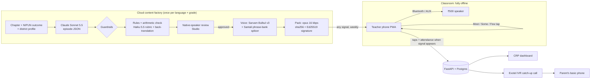
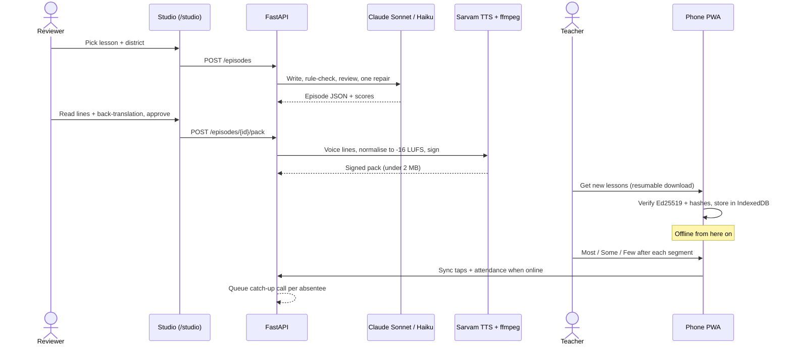
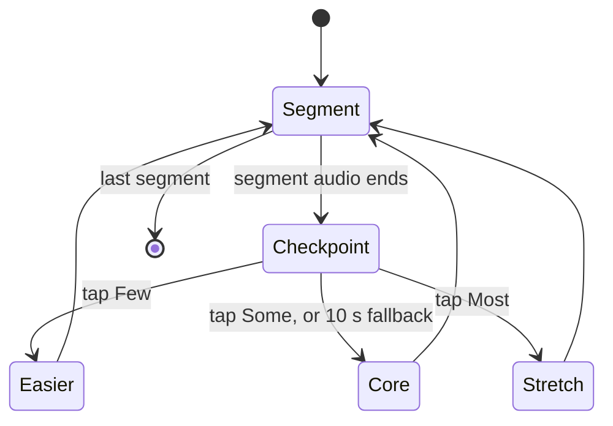
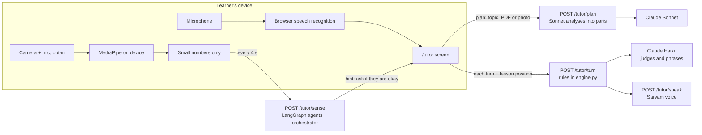
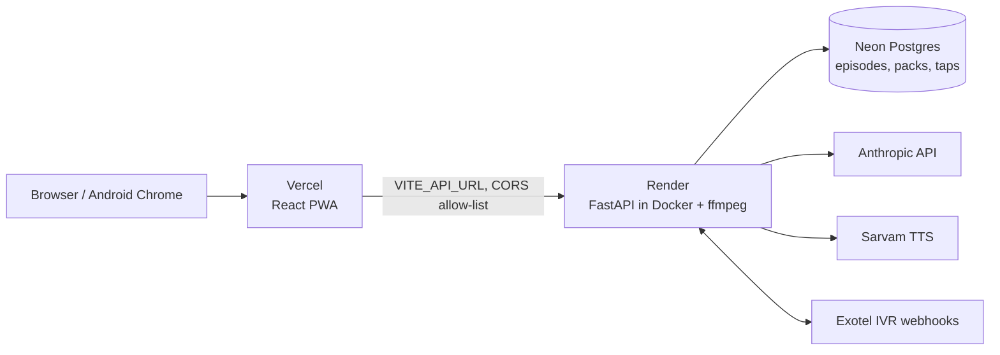

# Sahpaathi — an offline AI co-teacher in a ₹500 speaker

> While the teacher teaches one grade, a Bluetooth speaker paired to her phone runs a 15-minute interactive audio episode for another grade, in the children's home language, with **no internet in the classroom**.

**AI for Foundational Learning Hackathon 2026 · Challenge 01: Classroom Complexity · Team A1pha**

Sahpaathi brings back Interactive Radio Instruction (IRI) using frontier AI:
- **Claude writes the episodes.** It turns an NCERT/state textbook chapter and a NIPUN learning outcome into an IRI script localised to the district: names, crops, festivals, free props like pebbles and seeds. Every segment comes with pre-generated *easier / core / stretch* branches.
- **It adapts offline.** After each segment the teacher taps *Most / Some / Few got it*, and the episode switches branch on the device.
- **It starts in the home language.** Lessons begin in the child's home language (e.g. Hindi for migrant children in Tamil Nadu) and bridge into the school language (Tamil, Odia). Santali is next: its splicer is built, and the community phrase bank is waiting for consented recordings.
- **It reaches absent children.** A free call-back plays the missed lesson's recap on any basic phone.
- **It also has an online AI teacher** for one learner at a time: you talk to it like a person, ask it to teach a topic (or a photo of a textbook page), and it splits the topic into parts, teaches each, quizzes it and teaches it again until it lands. See *Two modes* below.

| Problem in the challenge | How Sahpaathi answers it |
|---|---|
| One teacher, 2–3 grades at once | The speaker guides one grade while the teacher teaches another |
| Home language ≠ school language | Episodes bridge from the home language to the school language |
| Absenteeism leaves gaps | An IVR catch-up call to the parent's basic phone |

## Two modes
Sahpaathi has two modes that share one curriculum and are kept separate on purpose. Each works on its own.

| | **Offline classroom** | **Online AI teacher** |
|---|---|---|
| For | A group in one room, one teacher phone and a ₹500 speaker | One learner on a phone with a signal |
| Internet | **None needed** | Needed |
| Does | Plays signed lesson packs through the speaker, branches on the teacher's *Most / Some / Few* taps, takes attendance, calls absent children's parents | Talks like a teacher: chats first, then plans a topic or a textbook page into parts, teaches each, quizzes it, teaches it again until it lands, answers doubts, and takes breaks with riddles and games |
| Languages | Tamil, Hindi, Odia, English (Santali next) | English, Hindi, Tamil, Odia, switchable mid-lesson |
| Open | [`/teacher`](https://sahpaathi.vercel.app/teacher) | [`/tutor`](https://sahpaathi.vercel.app/tutor) |
| Status | Complete, tested in airplane mode | **Prototype**, built early; see below |

**How the online AI teacher teaches.** The rules are in code, not in a prompt (`backend/app/tutor/engine.py`): it analyses the topic into 2 to 6 parts, teaches one part, asks its questions word for word, moves on only when they are answered, and gives a hint, then a simpler second explanation, then the answer when they are not. The learner can interrupt at any time ("explain again", "like I'm 5", "in Hindi") and the lesson keeps its place. After about ten turns, or when they say they are tired, it offers a break.

**Optional: the teacher notices how you are doing.** With the learner's opt-in, four LangGraph agents (face, posture, surroundings, response) read numbers made on the learner's own device from the camera and microphone and, when someone looks puzzled, tired or distracted or the room is noisy, the teacher simply **asks** if they are okay. Nothing is recorded, nothing leaves the device but those numbers, and saved moments are deleted when they press Stop or after 30 minutes. It needs legal review before children use it. All of this is rule-based for now and **has not been tested with real faces**: [docs/SENSE.md](docs/SENSE.md).

Not built yet, in either mode: a live two-way call between the teacher and the children, learner accounts and parental consent for the online mode, and the four lesson guardrails on the AI teacher's answers. The full list, and the plan for a **hybrid** (the AI teacher helping a child at home with what the class just learned): [docs/MODES.md](docs/MODES.md).

## Status
Build stage (18 Oct – 1 Nov 2026), submission target Sat 31 Oct. Plan and ownership: [docs/TEAM_PLAN.md](docs/TEAM_PLAN.md). What is done, what is open and what is not built: [docs/STATUS.md](docs/STATUS.md). Live: **https://sahpaathi.vercel.app** · API docs: **https://sahpaathi-api.onrender.com/docs**.

## System design
**AI where it is strong, in the cloud, once per language × grade. Zero internet in the classroom.** Full layer-by-layer table: [docs/ARCHITECTURE.md](docs/ARCHITECTURE.md).



### One lesson, end to end


### What the speaker does in class

The branch audio is pre-decoded on the phone, so switching is instant and needs no network.

### Guardrails: how wrong output is caught
1. **Schema + rules + arithmetic:** Pydantic contract, rule checks and a deterministic arithmetic checker (`backend/app/factory/rules.py`).
2. **Rubric review:** Haiku 5.5 scores pedagogy, age fit, accuracy, language bridge, localisation and safety; one automatic repair.
3. **Back-translation:** a blind English back-translation exposes drift in the home language.
4. **Human gate:** nothing is voiced until a native-speaker reviewer approves it in the Studio.
5. **Pack integrity:** every pack is Ed25519-signed with sha256 hashes; the app refuses any pack that fails verification. Voice lines are checked to -16 LUFS ±1.5 LU, under 45 s each, packs under 2 MB.

### Online mode: the AI teacher

The engine, not the model, decides what happens next: pass or reteach, when to take a break, when to resume. Nothing about the learner is stored on the server. Details: [docs/MODES.md](docs/MODES.md), [docs/SENSE.md](docs/SENSE.md).

### Deployment topology

Packs are stored in Postgres (under 2 MB each); move them to object storage if they outgrow it. Details: [docs/API.md](docs/API.md).

### Works without a network
| Part | Needs network? |
|---|---|
| Teacher player, branching, analogy, attendance, mic hint | No |
| Getting new lessons | Any signal, once a week; resumes after a 2G drop |
| Syncing taps and attendance | Queued locally until a signal appears |
| Catch-up call | The parent needs plain voice signal only |
| Writing and reviewing episodes (Studio) | Yes, not on the classroom path |

## Repository
```
backend/   FastAPI API, content factory (Claude), voice + pack builder, IVR, and the AI teacher (app/tutor: rules engine, Claude brain, LangGraph perception agents)
app/       Offline PWA: teacher player (/teacher), Studio (/studio), CRP dashboard + IVR simulator (/admin); online AI teacher (/tutor, src/tutor) and its opt-in camera sensing (src/sense)
ml/        training the perception model from labelled sessions (script, Colab notebook and prompt)
content/   curriculum text, district profiles, sample episodes, consented community voice clips
docs/      product, architecture, episode contract, API, plan, testing log, submission checklist
```

## Run locally
Requirements: Python 3.12, Node 24, Docker, ffmpeg.

```bash
# database
docker compose up -d

# backend → http://localhost:8000/docs
cd backend
python -m venv .venv && . .venv/bin/activate   # fish: . .venv/bin/activate.fish
pip install -r requirements-dev.txt
cp .env.example .env                           # fill in keys (see below)
alembic upgrade head                           # create tables
python -m app.seed                             # demo accounts (needs DEMO_PASSWORD in .env)
uvicorn app.main:app --reload
pytest -q                                      # SQLite by default; tests refuse any non-local database (they drop tables)
                                               # on Windows set PYTHONUTF8=1 first (a few tests read files without an encoding)

# generate + check + review one episode (needs ANTHROPIC_API_KEY in backend/.env)
python -m app.factory.judge ../content/curriculum/g1-numbers-to-20.json \
  ../content/districts/chennai-migrant.json > /tmp/episode.json
# review an existing episode only: add its path as a third argument

# app → http://localhost:5173/teacher
cd ../app
cp .env.example .env                           # API URL (and the demo password for the sign-in hint); never real secrets
npm install
npm run dev                                    # the AI teacher is at /tutor
npm test                                       # unit tests, including the privacy guard for the camera code
```

## External AI services and keys
| Service | What it does | Where it is called | Key |
|---|---|---|---|
| Anthropic Claude Sonnet 5.5 (`claude-sonnet-5-5`) | Writes the IRI episode script and branches as structured JSON | `backend/app/factory/` | `ANTHROPIC_API_KEY` |
| Anthropic Claude Sonnet 5.5 (again) | **AI teacher:** analyses a topic, PDF or photo of a page into a plan of parts (about 15 s, once per lesson) | `backend/app/tutor/brain.py` | `ANTHROPIC_API_KEY` |
| Anthropic Claude Haiku 5.5 (`claude-haiku-5-5`) | Blind English back-translation of every line, then a six-criterion rubric review (pedagogy, age fit, accuracy, language bridge, localisation, safety) | `backend/app/factory/` | `ANTHROPIC_API_KEY` |
| Anthropic Claude Haiku 5.5 (again) | **AI teacher:** every spoken turn: reads what the learner means, grades answers, and words the reply, in about 1.5 to 3 s | `backend/app/tutor/brain.py` | `ANTHROPIC_API_KEY` |
| Sarvam AI Bulbul v3 (`bulbul:v3`) | Tamil / Hindi / Odia / English voices, generated in the cloud before packing (never in class). Santali will be spliced from consented community recordings instead (splicer built, recordings pending) | `backend/app/voice/` | `TTS_API_KEY` |
| Sarvam AI Bulbul v3 (again) | **AI teacher:** speaks each reply; if no key is set the browser's own voice is used | `backend/app/tutor/` | `TTS_API_KEY` (optional) |
| Google MediaPipe face and pose landmarkers (Apache-2.0) | **Opt-in sensing:** read facial cues and posture **in the learner's browser**; the model files load from Google's storage and the runtime from jsDelivr on first use (about 10 MB). Nothing is sent to them | `app/src/sense/` | none |
| LangGraph (library) | Runs the four perception agents in parallel and the orchestrator that weighs them | `backend/app/tutor/sense/` | none |
| Exotel / Twilio | Absentee catch-up call + DTMF keypad branching | `backend/app/ivr/` | `EXOTEL_*` (calls ring only `EXOTEL_ALLOWED_NUMBERS`) |

Nothing above runs in the offline classroom. The teacher player works with **zero connectivity** once a weekly pack is on the phone. The AI teacher is the online mode and needs a connection.

## Deploy (free tiers)
Live: app **https://sahpaathi.vercel.app** (teacher player at `/teacher`, `/studio`, `/admin`), API **https://sahpaathi-api.onrender.com**.

- **Database: Neon.** Create a project and copy its `postgresql://...` connection string.
- **Backend: Render.** New → Blueprint → this repo (`render.yaml`). Paste `DATABASE_URL`, `ANTHROPIC_API_KEY`, `DEMO_PASSWORD`, `CORS_ORIGINS` (the app's URL), `TTS_API_KEY`, `PACK_SIGNING_KEY`. `JWT_SECRET` is generated. The AI teacher is open to anyone, so it is capped per UTC day, overall and per caller (`TUTOR_DAILY_TURNS`/`TUTOR_DAILY_VOICE`, default 600; `TUTOR_IP_DAILY_TURNS`/`TUTOR_IP_DAILY_VOICE`, default 100; plans from files 40 overall and 6 per caller), then HTTP 429. Real calls ring only `EXOTEL_ALLOWED_NUMBERS`. Caps are stored in the database, so deploys do not reset them. Each start runs migrations and refreshes the demo accounts.
- **App: Vercel.** Import the repo with root directory `app/`, and set `VITE_API_URL` (the Render URL) and `VITE_PACK_PUBLIC_KEY`. The Studio and Admin sign-in pages fetch the demo accounts' password from the API (`GET /api/v1/auth/demo`), so no Vercel setting is needed for it. Every merge to `main` deploys through `.github/workflows/deploy-app.yml`. `app/vercel.json` serves `index.html` for `/studio` and `/admin`. From a laptop instead of a Git import: `npx vercel deploy --prod` at the repo root; `.vercelignore` uploads only `app/` and `content/`. Then put the Vercel URL in Render's `CORS_ORIGINS`, e.g. `https://sahpaathi.vercel.app`; without it the browser blocks every API call, including the player's sync.
- **One signing key for the team.** `PACK_SIGNING_KEY` (private) lives only in Render and in the `backend/.env` of whoever builds packs locally; `VITE_PACK_PUBLIC_KEY` is its public half. A pack signed with any other key is refused by the app.

## Test credentials and sample inputs
Live app: **https://sahpaathi.vercel.app**. All three accounts share one password: **[DEMO_PASSWORD, given to evaluators]**.

| Role | Email | Where to start | Try this |
|---|---|---|---|
| Teacher | `teacher@sahpaathi.test` | [/teacher](https://sahpaathi.vercel.app/teacher) | No login needed to play the built-in lesson, even in airplane mode: tap a checkpoint, let the 10 s fallback play, take attendance. Sign in under **Get new lessons** to download a voiced Tamil lesson. Switch the language at the top (English, தமிழ், हिन्दी, ଓଡ଼ିଆ) |
| Reviewer | `reviewer@sahpaathi.test` | [/studio](https://sahpaathi.vercel.app/studio) | Open a lesson, read each line beside its English back-translation and the AI review, correct a line with the pencil, then approve or reject |
| Admin | `admin@sahpaathi.test` | [/admin](https://sahpaathi.vercel.app/admin) | Overview charts and the lesson pipeline; **Lesson packs** to build and download a signed pack; **Catch-up calls** to queue a call for an absent roll number and press 1, 2 or 3 on the keypad simulator |

**Try the online AI teacher** at [/tutor](https://sahpaathi.vercel.app/tutor) (no login; needs the internet and Chrome, Edge or Safari for speech). Say "hello", then "teach me place value of two digit numbers" or attach a photo of a textbook page. Answer wrongly on purpose to see the hint and the second explanation, say "I'm tired" to get a break, or "explain in Hindi". The optional camera sensing is on the same page; **please use adults only** until it has had legal review.

**Sample inputs for the Studio's "Write a new lesson"** (about five minutes each; Claude writes, a second model reviews):
1. Grade 1 · NCERT numbers 1 to 20 · **Chennai: Hindi to Tamil** (a migrant child's home language bridged to the Tamil-medium school)
2. Grade 1 · NCERT addition (putting together) · **Madurai: Tamil**
3. Grade 2 · NCERT tens and ones · **Madurai: Tamil**
4. Grade 3 · NCERT subtraction with regrouping · Chennai: Hindi to Tamil
5. Grade 3 · NCERT multiplication as equal groups · Madurai: Tamil

## License
[MIT](LICENSE). Open source so state programmes and NGOs can adapt it.
