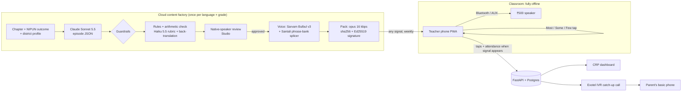
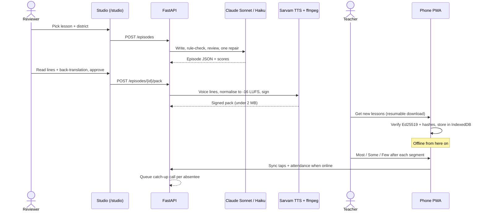
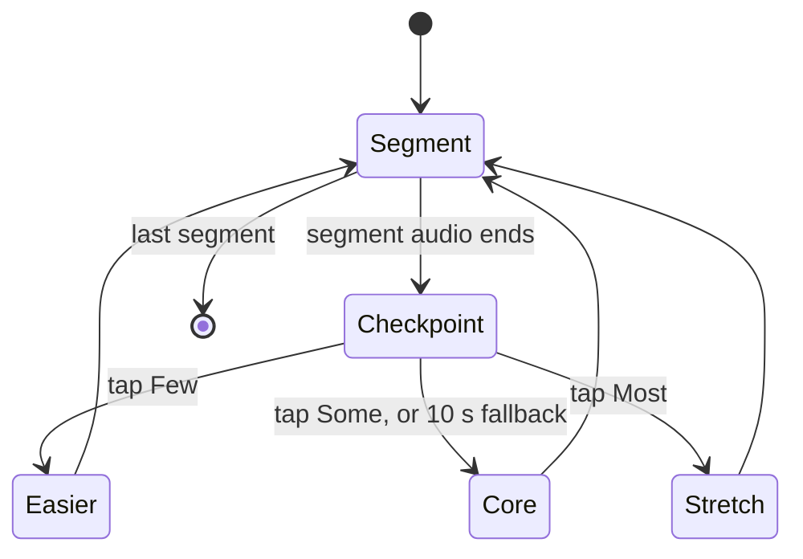
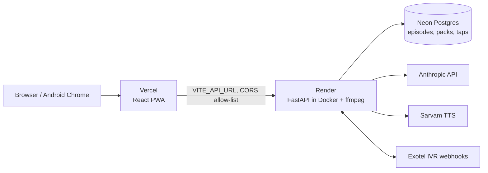

# Sahpaathi — an offline AI co-teacher in a ₹500 speaker

> While the teacher teaches one grade, a Bluetooth speaker paired to her phone runs a 15-minute interactive audio episode for another grade, in the children's home language, with **no internet in the classroom**.

**AI for Foundational Learning Hackathon 2026 · Challenge 01: Classroom Complexity · Team A1pha**

Sahpaathi brings back Interactive Radio Instruction (IRI) using frontier AI:
- **Claude writes the episodes.** It turns an NCERT/state textbook chapter and a NIPUN learning outcome into an IRI script localised to the district: names, crops, festivals, free props like pebbles and seeds. Every segment comes with pre-generated *easier / core / stretch* branches.
- **It adapts offline.** After each segment the teacher taps *Most / Some / Few got it*, and the episode switches branch on the device.
- **It starts in the home language.** Lessons begin in the child's home language (e.g. Hindi for migrant children in Tamil Nadu) and bridge into the school language (Tamil, Odia). Santali is next: its splicer is built, and the community phrase bank is waiting for consented recordings.
- **It reaches absent children.** A free call-back plays the missed lesson's recap on any basic phone.

| Problem in the challenge | How Sahpaathi answers it |
|---|---|
| One teacher, 2–3 grades at once | The speaker guides one grade while the teacher teaches another |
| Home language ≠ school language | Episodes bridge from the home language to the school language |
| Absenteeism leaves gaps | An IVR catch-up call to the parent's basic phone |

## Two modes
| | Offline classroom | Online AI teacher |
|---|---|---|
| For | A group in one room, one teacher phone and a ₹500 speaker | One learner on a phone with a signal |
| Internet | **None needed** | Needed |
| Does | Plays signed lesson packs, branches on the teacher's *Most / Some / Few* taps, takes attendance, calls absent children's parents | Talks like a teacher: plans a topic or textbook page into parts, teaches, quizzes, reteaches, answers doubts in any of four languages, takes breaks with riddles and games |
| Open | [`/teacher`](https://sahpaathi.vercel.app/teacher) | [`/tutor`](https://sahpaathi.vercel.app/tutor) |

They share one curriculum and are kept separate on purpose; a hybrid is planned. In the online mode a learner can opt in to let the teacher notice (on their own device, numbers only) when they look puzzled or tired or it is noisy, and ask if they are okay: [docs/SENSE.md](docs/SENSE.md). What is built and what is not, in each: [docs/MODES.md](docs/MODES.md).

## Status
Build stage (18 Oct – 1 Nov 2026), submission target Sat 31 Oct. Plan and ownership: [docs/TEAM_PLAN.md](docs/TEAM_PLAN.md). Live: **https://sahpaathi.vercel.app** · API docs: **https://sahpaathi-api.onrender.com/docs**.

## System design
**AI where it is strong, in the cloud, once per language × grade. Zero internet in the classroom.** Full layer-by-layer table: [docs/ARCHITECTURE.md](docs/ARCHITECTURE.md).



### One lesson, end to end


### What the speaker does in class

The branch audio is pre-decoded on the phone, so switching is instant and needs no network.

### Guardrails: how wrong output is caught
1. **Schema + rules + arithmetic:** Pydantic contract, rule checks and a deterministic arithmetic checker (`backend/app/factory/rules.py`).
2. **Rubric review:** Haiku 5.5 scores pedagogy, age fit, accuracy, language bridge, localisation and safety; one automatic repair.
3. **Back-translation:** a blind English back-translation exposes drift in the home language.
4. **Human gate:** nothing is voiced until a native-speaker reviewer approves it in the Studio.
5. **Pack integrity:** every pack is Ed25519-signed with sha256 hashes; the app refuses any pack that fails verification. Voice lines are checked to -16 LUFS ±1.5 LU, under 45 s each, packs under 2 MB.

### Deployment topology

Packs are stored in Postgres (under 2 MB each); move them to object storage if they outgrow it. Details: [docs/API.md](docs/API.md).

### Works without a network
| Part | Needs network? |
|---|---|
| Teacher player, branching, analogy, attendance, mic hint | No |
| Getting new lessons | Any signal, once a week; resumes after a 2G drop |
| Syncing taps and attendance | Queued locally until a signal appears |
| Catch-up call | The parent needs plain voice signal only |
| Writing and reviewing episodes (Studio) | Yes, not on the classroom path |

## Repository
```
backend/   FastAPI API, content factory (Claude), voice + pack builder, IVR
app/       Offline PWA: teacher player (/teacher), Studio (/studio), CRP dashboard + IVR simulator (/admin); online AI teacher (/tutor)
content/   curriculum text, district profiles, sample episodes, consented community voice clips
docs/      product, architecture, episode contract, API, plan, testing log, submission checklist
```

## Run locally
Requirements: Python 3.12, Node 24, Docker, ffmpeg.

```bash
# database
docker compose up -d

# backend → http://localhost:8000/docs
cd backend
python -m venv .venv && . .venv/bin/activate   # fish: . .venv/bin/activate.fish
pip install -r requirements-dev.txt
cp .env.example .env                           # fill in keys (see below)
alembic upgrade head                           # create tables
python -m app.seed                             # demo accounts (needs DEMO_PASSWORD in .env)
uvicorn app.main:app --reload
pytest -q                                      # SQLite by default; set DATABASE_URL to test on Postgres

# generate + check + review one episode (needs ANTHROPIC_API_KEY in backend/.env)
python -m app.factory.judge ../content/curriculum/g1-numbers-to-20.json \
  ../content/districts/chennai-migrant.json > /tmp/episode.json
# review an existing episode only: add its path as a third argument

# app → http://localhost:5173/teacher
cd ../app
cp .env.example .env                           # API URL only; never secrets
npm install
npm run dev
```

## External AI services and keys
| Service | What it does | Where it is called | Key |
|---|---|---|---|
| Anthropic Claude Sonnet 5.5 (`claude-sonnet-5-5`) | Writes the IRI episode script and branches as structured JSON | `backend/app/factory/` | `ANTHROPIC_API_KEY` |
| Anthropic Claude Haiku 5.5 (`claude-haiku-5-5`) | Blind English back-translation of every line, then a six-criterion rubric review (pedagogy, age fit, accuracy, language bridge, localisation, safety) | `backend/app/factory/` | `ANTHROPIC_API_KEY` |
| Sarvam AI Bulbul v3 (`bulbul:v3`) | Tamil / Hindi / Odia / English voices, generated in the cloud before packing (never in class). Santali will be spliced from consented community recordings instead (splicer built, recordings pending) | `backend/app/voice/` | `TTS_API_KEY` |
| Exotel / Twilio | Absentee catch-up call + DTMF keypad branching | `backend/app/ivr/` | `TELEPHONY_*` |

Nothing above runs in the classroom. The teacher player works with **zero connectivity** once a weekly pack is on the phone.

## Deploy (free tiers)
Live: app **https://sahpaathi.vercel.app** (teacher player at `/teacher`, `/studio`, `/admin`), API **https://sahpaathi-api.onrender.com**.

- **Database: Neon.** Create a project and copy its `postgresql://...` connection string.
- **Backend: Render.** New → Blueprint → this repo (`render.yaml`). Paste `DATABASE_URL`, `ANTHROPIC_API_KEY`, `DEMO_PASSWORD`, `CORS_ORIGINS` (the app's URL as a JSON list), `TTS_API_KEY`, `PACK_SIGNING_KEY`. `JWT_SECRET` is generated. Each start runs migrations and refreshes the demo accounts.
- **App: Vercel.** Import the repo with root directory `app/`, and set `VITE_API_URL` (the Render URL) and `VITE_PACK_PUBLIC_KEY`. `app/vercel.json` serves `index.html` for `/studio` and `/admin`. From a laptop instead of a Git import: `npx vercel deploy --prod` at the repo root; `.vercelignore` uploads only `app/` and `content/`. Then put the Vercel URL in Render's `CORS_ORIGINS`, e.g. `["https://sahpaathi.vercel.app"]`; without it the browser blocks every API call, including the player's sync.
- **One signing key for the team.** `PACK_SIGNING_KEY` (private) lives only in Render and in the `backend/.env` of whoever builds packs locally; `VITE_PACK_PUBLIC_KEY` is its public half. A pack signed with any other key is refused by the app.

## Test credentials and sample inputs
Live app: **https://sahpaathi.vercel.app**. All three accounts share one password: **[DEMO_PASSWORD, given to evaluators]**.

| Role | Email | Where to start | Try this |
|---|---|---|---|
| Teacher | `teacher@sahpaathi.test` | [/teacher](https://sahpaathi.vercel.app/teacher) | No login needed to play the built-in lesson, even in airplane mode: tap a checkpoint, let the 10 s fallback play, take attendance. Sign in under **Get new lessons** to download a voiced Tamil lesson. Switch the language at the top (English, தமிழ், हिन्दी, ଓଡ଼ିଆ) |
| Reviewer | `reviewer@sahpaathi.test` | [/studio](https://sahpaathi.vercel.app/studio) | Open a lesson, read each line beside its English back-translation and the AI review, correct a line with the pencil, then approve or reject |
| Admin | `admin@sahpaathi.test` | [/admin](https://sahpaathi.vercel.app/admin) | Overview charts and the lesson pipeline; **Lesson packs** to build and download a signed pack; **Catch-up calls** to queue a call for an absent roll number and press 1, 2 or 3 on the keypad simulator |

**Sample inputs for the Studio's "Write a new lesson"** (about five minutes each; Claude writes, a second model reviews):
1. Grade 1 · NCERT numbers 1 to 20 · **Chennai: Hindi to Tamil** (a migrant child's home language bridged to the Tamil-medium school)
2. Grade 1 · NCERT addition (putting together) · **Madurai: Tamil**
3. Grade 2 · NCERT tens and ones · **Madurai: Tamil**
4. Grade 3 · NCERT subtraction with regrouping · Chennai: Hindi to Tamil
5. Grade 3 · NCERT multiplication as equal groups · Madurai: Tamil

## License
[MIT](LICENSE). Open source so state programmes and NGOs can adapt it.
