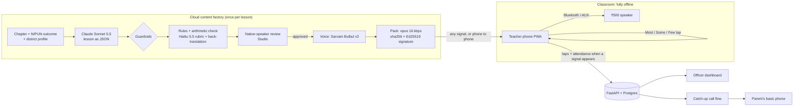
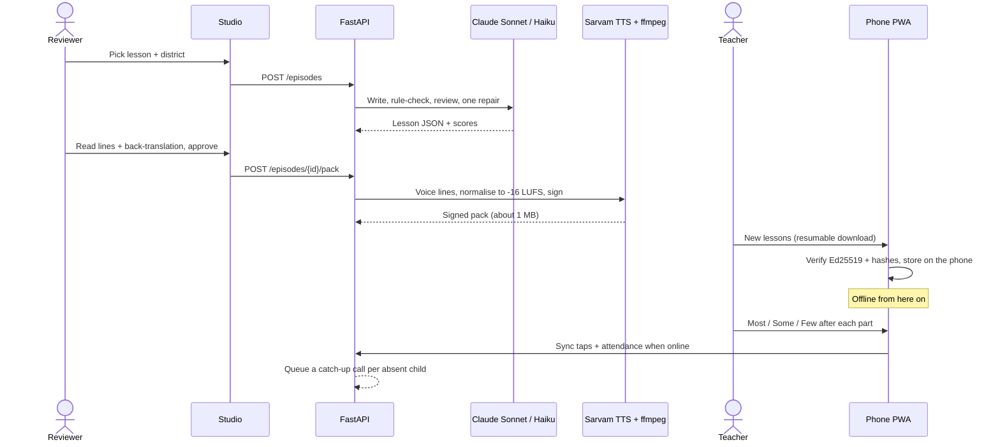
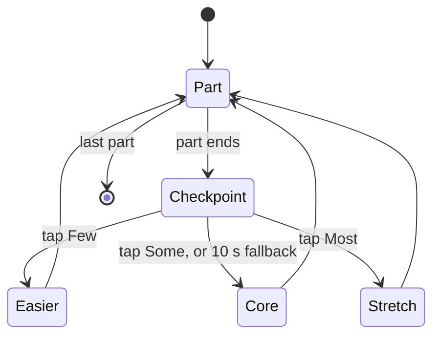

# Sahpaathi

**An offline audio learning companion for multigrade classrooms, in a ₹500 speaker.**

While the teacher works closely with one group of children, Sahpaathi keeps another group engaged with a structured, interactive audio activity in the children's home language. It runs from the teacher's phone through a Bluetooth speaker, adapts to the class with one tap, and needs **no internet in the classroom**.

**Live:** [sahpaathi.vercel.app](https://sahpaathi.vercel.app) · **API docs:** [sahpaathi-api.onrender.com/docs](https://sahpaathi-api.onrender.com/docs) · **License:** MIT

---

## Features

**For the teacher, in class (fully offline)**
- **One tap to start.** Today's plan, how to set up the room, what to keep ready (pebbles, slates, seeds), and a chalk sketch to draw on the board, in English, Tamil, Hindi or Odia.
- **Lessons that talk and wait.** Call-and-response, pebble tasks, slate work, pair work, songs and stories, with timed pauses for the children to answer.
- **Adapts with one tap.** After each part the teacher taps *Most*, *Some* or *Few got it*, and the lesson moves to a stretch, more practice or an easier path, on the phone. No tap in 10 seconds and it carries on.
- **Home language first.** Lessons open in the child's home language (for example Hindi for migrant children in Tamil Nadu) and bridge into the school language.
- **Classroom controls.** Pause, replay a line, skip, a simpler analogy on demand, an attention bell, slower speech, longer answer time, a voice boost and a room-noise check.
- **Attendance and history.** Mark who was absent by roll number; see how the class did, lesson by lesson. Everything is saved on the phone and syncs when a signal appears.
- **Plan, record and shelf.** A timetable per grade, the teacher's own voice recordings with AI feedback, and offline PDFs and official book links by subject and grade.

**For reviewers (Studio)**
- Claude writes a lesson for any chapter and district. Each line sits beside its English back-translation and the AI review scores. The reviewer corrects lines and approves, and only approved lessons are voiced.
- A feedback loop: parts that classes struggled with can be rewritten by Claude and go back through review.

**For block and cluster officers (Admin)**
- Class-health board: which classes need support, which parts of lessons were hardest, week-by-week trends.
- Signed lesson packs, built from approved lessons.
- **Catch-up calls:** every absent child gets a call queued to a parent's basic phone. It plays the lesson recap; the parent presses 1 to hear it again, 2 if the child understood, 3 for help. A keypad simulator runs the same call flow in the browser.

**For families at home (prototype)**
- A **parent helper** at `/tutor`: a parent and child talk to it about a topic or a photo of a textbook page; it explains in parts, asks questions and explains again, in English, Hindi, Tamil or Odia. Needs internet.

## How it works

AI runs **once per lesson, in the cloud**. The classroom only replays the approved, voiced result, so nothing in the room needs a network and no unreviewed AI output reaches children.



### One lesson, end to end


### In class

The next line and all three branches are preloaded on the phone, so a tap plays at once.

### Guardrails
1. **Code:** a schema contract, rule checks, every sum recomputed, and the home-language handover checked (`backend/app/factory/rules.py`).
2. **AI rubric:** Claude Haiku scores teaching, age fit, accuracy, language bridge, local fit and safety, with one automatic repair.
3. **Back-translation:** a blind English translation beside every line exposes meaning drift.
4. **Human approval:** nothing is voiced until a native-speaker reviewer approves it; the AI's original wording is kept.
5. **Pack integrity:** packs are Ed25519-signed with sha256 hashes, and the app refuses any pack that fails. Audio is checked to -16 LUFS ±1.5 LU, lines under 45 s, packs under 2 MB.

On 20 planted defects (wrong sums, beyond-grade maths, unsafe instructions, a dropped home language, answers given too early), code and the AI reviewer flagged all 20 and pinpointed 18, before any human review ([docs/GUARDRAIL_EVAL.md](docs/GUARDRAIL_EVAL.md)).

### Low connectivity, low cost
| Part | Network |
|---|---|
| Lesson player, branching, analogy, attendance | None |
| New lessons | Any signal; a dropped 2G download resumes; packs can also be shared phone to phone |
| Syncing taps and attendance | Queued on the phone, sent when a signal appears |
| Catch-up call | The parent needs voice signal only: no smartphone, no data |
| Studio, Admin, parent helper | Online tools, not on the classroom path |

Runs on any Android phone with Chrome and any Bluetooth or AUX speaker. A voiced 10-minute lesson is about 1.1 MB. A repeat visit on emulated slow 3G loads in 0.5 s, and Lighthouse accessibility scores 100.

## Try it

Open **[sahpaathi.vercel.app](https://sahpaathi.vercel.app)**. The demo accounts share one password: **`sahpaathi#01`** (the sign-in pages also show it).

| Role | Email | Open |
|---|---|---|
| Teacher | `teacher@sahpaathi.test` | [/teacher](https://sahpaathi.vercel.app/teacher) (no login needed to play) |
| Reviewer | `reviewer@sahpaathi.test` | [/studio](https://sahpaathi.vercel.app/studio) |
| Admin / block officer | `admin@sahpaathi.test` | [/admin](https://sahpaathi.vercel.app/admin) |
| Parent helper | none | [/tutor](https://sahpaathi.vercel.app/tutor) |

**Sample inputs**
1. **Teacher, offline:** open *Counting to three with pebbles*, read *Set up the room*, press Start. Listen, tap *Few got it*, then *Most got it* at the next checkpoint. Let one checkpoint run out: it continues after 10 s. At the end, mark two roll numbers absent.
2. **Teacher, voiced pack:** under *New lessons*, sign in and download *கூழாங்கல் எண்ணுவோம்* (Grade 1, Hindi to Tamil, 15 min). It is signature-checked. Turn on airplane mode and play it.
3. **Reviewer:** in the Studio open *Approved*, then the Grade 3 Madurai lesson. Read each Tamil line beside its English back-translation and the six AI scores.
4. **Admin:** open *Classes* (the board uses clearly labelled sample data), then *Catch-up calls*: queue a call for roll R-07, press *Simulate*, *Dial*, and press 1, 2 or 3 at any time.
5. **Parent helper:** turn on *Study* and type "place value of two-digit numbers". Answer one question wrongly, then say "explain in Hindi" and "I am tired".

**Test it offline:** open `/teacher` in Android Chrome, wait a few seconds for it to save itself (Add to Home screen is optional), turn on airplane mode, then open a lesson.

## AI models and services
| Service | What it does | Where | Key |
|---|---|---|---|
| Claude Sonnet 5.5 (`claude-sonnet-5-5`) | Writes each lesson and its branches as structured JSON; rewrites parts classes struggled with; plans topics in the parent helper | `backend/app/factory/`, `backend/app/tutor/brain.py` | `ANTHROPIC_API_KEY` |
| Claude Haiku 5.5 (`claude-haiku-5-5`) | Back-translation and the six-criterion rubric review; feedback on teacher recordings; each turn of the parent helper | `backend/app/factory/`, `backend/app/recordings.py`, `backend/app/tutor/` | `ANTHROPIC_API_KEY` |
| Sarvam Bulbul v3 (`bulbul:v3`) | Tamil, Hindi, Odia and English voices, generated before packing (never in class) | `backend/app/voice/` | `TTS_API_KEY` |
| Sarvam Saarika v2.5 | Transcribes a teacher's own recording for the AI feedback | `backend/app/recordings.py` | `TTS_API_KEY` |
| Exotel | Real catch-up calls with keypad (DTMF) answers; rings only `EXOTEL_ALLOWED_NUMBERS` | `backend/app/ivr/` | `EXOTEL_*` |

No AI model runs in the classroom. Branching is plain code on the phone; in the parent helper, code rules decide pass, hint and reteach, and the model only words the replies.

## Stack
- **App:** React, TypeScript, Vite, Tailwind, installable PWA with a service worker; lesson packs stored on the phone (IndexedDB). Hosted on Vercel.
- **Backend:** FastAPI, SQLAlchemy, Alembic, Postgres (Neon), ffmpeg; Docker on Render.
- **Quality:** pytest and vitest (coverage floors), a browser smoke test with accessibility checks on every page (desktop and phone), lint with `jsx-a11y`, secret and dependency scans in CI.

## Run locally
Requirements: Python 3.12, Node 24, Docker, ffmpeg.

```bash
# database
docker compose up -d

# backend → http://localhost:8000/docs
cd backend
python -m venv .venv && . .venv/bin/activate
pip install -r requirements-dev.txt
cp .env.example .env              # add your keys (see the table above)
alembic upgrade head
python -m app.seed                # demo accounts (needs DEMO_PASSWORD in .env)
uvicorn app.main:app --reload
pytest -q                         # tests use SQLite and refuse any non-local database

# write, check and review one lesson from the command line
python -m app.factory.judge ../content/curriculum/g1-numbers-to-20.json \
  ../content/districts/chennai-migrant.json > /tmp/episode.json

# app → http://localhost:5173/teacher
cd ../app
cp .env.example .env              # API URL and the pack public key; never secrets
npm install
npm run dev
npm test
```

## Deploy
- **Database:** Neon. Copy its `postgresql://` connection string.
- **Backend:** Render Blueprint from `render.yaml`. Set `DATABASE_URL`, `ANTHROPIC_API_KEY`, `TTS_API_KEY`, `PACK_SIGNING_KEY`, `DEMO_PASSWORD` and `CORS_ORIGINS` (the app's URL); `JWT_SECRET` is generated. Public and paid endpoints have daily caps stored in the database and return HTTP 429 when reached. Each start runs migrations and refreshes the demo accounts.
- **App:** Vercel with root directory `app/`. Set `VITE_API_URL` and `VITE_PACK_PUBLIC_KEY` (the public half of `PACK_SIGNING_KEY`; the app refuses packs signed with any other key). Merges to `main` deploy through `.github/workflows/deploy-app.yml`.

## Repository
```
backend/   FastAPI API, lesson factory (Claude), guardrails, voice and pack builder, catch-up calls, parent helper
app/       PWA: teacher app (/teacher), Studio (/studio), Admin (/admin), parent helper (/tutor)
content/   curriculum chapters, district profiles, built-in lessons and their voices
docs/      architecture, lesson contract, API, generation prompts, guardrail evaluation, testing log, roadmap
ml/        tools for a future learned model
```
More detail: [Architecture](docs/ARCHITECTURE.md) · [Lesson contract](docs/EPISODE_SCHEMA.md) · [API](docs/API.md) · [Testing log](docs/TESTING_LOG.md) · [Roadmap](docs/ROADMAP.md)

## Roadmap
- **Classroom pilots** with a DIET or Block Resource Centre in 10 to 20 multigrade schools, measuring engaged minutes per child, how often most children got it after branching, and catch-up call completion.
- **More lessons and subjects:** Grades 1 to 3 numeracy aligned to NIPUN Bharat, then early literacy; state teacher guides as generation input.
- **More languages:** scheduled languages through Indic TTS, each with native reviewers; tribal languages (Santali first) through consented community phrase banks, for which the splicer is built.
- **Live calling** through Exotel to parents' phones, and state IVR lines and community radio as further channels.
- **Integration:** lessons tagged by NIPUN learning outcome, dashboards that roll up to block and district, cluster resource persons carrying packs, and approved lessons published to DIKSHA.
- **Parent helper:** the four guardrails on its answers, and verified parental consent before any child account.

## About
Built by Team A1pha (Harshavardhan K, Sanjjith B, Loktrishal K, Cholan Kinnera) for the AI for Foundational Learning Hackathon 2026, Challenge: Classroom Complexity. Open source under the [MIT license](LICENSE) so state programmes and NGOs can adapt it.
