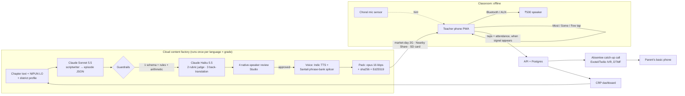

# Architecture

**AI where it's strong, in the cloud, once per language × grade. Zero internet in the classroom.**

## Layers (how we'll explain it to judges)
| Layer | What happens | Where |
|---|---|---|
| Data input | NCERT / Tamil Nadu chapter text, NIPUN Bharat learning outcome, district profile (home + school language, names, crops, festivals, fauna, free props), last week's taps | `content/`, Studio form |
| Processing | Sonnet 5.5 writes the IRI episode as schema-constrained JSON: segments, pauses, cues, 3 branches, analogy, IVR recap, chalk-sketch SVG | `backend/app/factory/` |
| Guardrails | 1) Pydantic schema + rule checks + deterministic arithmetic check; 2) Haiku 5.5 rubric (pedagogy, age-fit, accuracy, safety), one auto-regenerate; 3) back-translation drift; 4) human native-speaker approval | `backend/app/factory/`, Studio |
| Evaluation | Guardrail scores stored per episode; in class, the tap logs give % "Most got it" per segment; catch-up call completion | Dashboard |
| Output | Signed 2 MB-class packs → offline player → speaker; recap → IVR call | `voice/`, `app/src/teacher/`, `ivr/` |

## What needs connectivity, and what degrades gracefully
| Part | Needs network? | Offline behaviour |
|---|---|---|
| Teacher player, branching, analogy, attendance, mic sensor | **No** | Fully works. Taps and attendance queue locally |
| Getting new packs | Any signal, once a week | 4 weeks cached ahead; packs also move phone-to-phone or by SD card |
| Sync taps / attendance | Any signal | Queued until a signal appears, then sent in one small request |
| Catch-up call | Parent needs plain voice signal only, no data | Queued until the attendance sync arrives |
| Generating / reviewing episodes (Studio) | Yes (cloud) | Not on the classroom path |

## Stack
- **App:** Vite + React + TypeScript + Tailwind + vite-plugin-pwa. Packs stored in IndexedDB/Cache API; branch audio pre-decoded with Web Audio for instant switching. Hosted on Vercel / Cloudflare Pages.
- **Backend:** FastAPI + SQLAlchemy + Alembic + Postgres (Neon). ffmpeg for audio. Docker on Render. Packs on Cloudflare R2.
- **Hardware:** any ₹7k Android (Chrome) + ₹500 Bluetooth speaker (3.5 mm AUX fallback); any keypad phone for the call.
