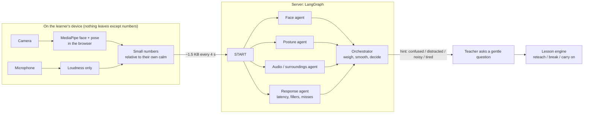

# The AI teacher notices how you are doing (perception agents)

A good teacher watches the face in front of her. The online AI teacher can do a careful version of
that, **only if the learner turns it on**: it notices when someone looks puzzled, tired or distracted,
or when it is noisy around them, and then simply **asks** ("is it clear, or shall I explain it another
way?"). It never grades from this, and it never says what it saw.

## How it works

| Agent | Looks at | Signals it can raise |
|---|---|---|
| Face | brow down, squint, pressed lips, eyes heavy, yawn, gaze and head turned away | confused, tired, distracted, uncomfortable |
| Posture | slouching, leaning away, a hand at the face | tired, distracted, uncomfortable |
| Audio / surroundings | background sound above the room's own usual level (while the learner is not speaking; discounted while the teacher's voice plays) | noisy |
| Response | how long they took to answer, "umm"s, missed questions, long silence | confused, tired, distracted |
| **Orchestrator** | combines them (noisy-OR: one strong witness is enough, agreement makes it stronger) and needs about six seconds of evidence and a high score before it suggests anything | one of the five, or "focused" |

When a hint fires, the app calls the lesson engine with that signal and **no student words**. The
teacher asks one gentle question (a tired learner is offered a break instead). What the learner
answers is what the teacher acts on: "explain again" re-teaches, "it's noisy" offers a break, "I'm
fine" carries on. A check-in comes at most once every 90 seconds and five times a session.

## Privacy: what we promise and how it is built

- **Opt-in, every session.** A plain-language card explains it first; nothing starts until the learner taps Allow, and a Stop button is always on screen with a small self-view so they can see the camera is on.
- **Raw video and audio never leave the device.** Frames go to MediaPipe running in the browser (WebAssembly). The microphone is reduced to a loudness number. The server receives only the numbers in `backend/app/tutor/sense/schema.py` and **stores and logs nothing**.
- **Relative, not absolute.** Every number is "above this person's own calm", measured in the first 8 seconds.
- **A hint, not a verdict.** It cannot change a score, a pass or a plan. It can only make the teacher ask.
- **The learner owns their own data.** *I get it / I'm lost* label a moment; the labelled numbers can be downloaded as a CSV and are never uploaded.

### Limits and risks, plainly

- **Reading emotion from faces is unreliable.** Expressions differ between people, cultures and cameras, glasses, lighting and angle change the numbers, and a puzzled look is not proof of confusion. That is why it only asks.
- **Law.** India's DPDP Act 2023 restricts tracking and behavioural monitoring of children and needs verifiable parental consent; the EU AI Act bans emotion inference in schools. **Get legal review and a parental-consent flow before children use this.** Until then it is an opt-in demo for adults and consenting older learners.
- **Not tested with real faces yet.** The tests use synthetic numbers, and the browser test used a fake camera (no person in view, so face and posture came back empty). The thresholds are priors, not measurements.
- The model files and WebAssembly runtime are fetched from Google's and jsDelivr's servers the first time (about 10 MB); a fully self-hosted copy would remove that dependency.

## Training a real model (Colab)

There is no labelled data yet, so the agents start with hand-set rules (priors). The path to a real model:

1. **Collect.** Learners tap *I get it* or *I'm lost* while the teacher watches. Each tap saves that moment's numbers with their own label. They download the CSV.
2. **Train.** Open `ml/train_sense.ipynb` in Google Colab, upload `ml/train_sense.py` and the CSVs, run it. It trains a small logistic regression, reports a cross-validated AUC, refuses data that is too small (under 60 rows, or under 20 of a label), and writes `weights.json` with the scaling already folded in.
3. **Ship.** Put `weights.json` at `backend/app/tutor/sense/weights.json` in a pull request. The orchestrator uses it in place of the hand-set "confused" rule; everything else stays rule-based.

`ml/make_synthetic.py` makes **invented** data only to prove the pipeline end to end. Never train
production weights on it. Aim for several hundred labelled moments from many different people, rooms
and lighting before trusting the result (AUC below about 0.7 means it barely beats guessing).

## Where the code is

| What | Where |
|---|---|
| Landmarks to numbers, baseline, noise floor | `app/src/sense/features.ts` (unit tested) |
| Camera, microphone, MediaPipe, the loop | `app/src/sense/useSense.ts`, `vision.ts` |
| Consent card, self-view, labels | `app/src/sense/SensePanel.tsx` |
| The agents and the LangGraph orchestrator | `backend/app/tutor/sense/` |
| Check-in in the lesson | `backend/app/tutor/engine.py` (`signal`) |
| Training | `ml/` |
