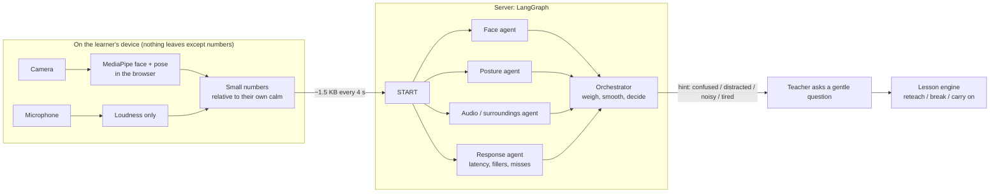

# The AI teacher notices how you are doing (perception agents)

A good teacher watches the face in front of her. The online AI teacher can do a careful version of
that, **only if the learner turns it on**: it notices when someone looks puzzled, tired or distracted,
or when it is noisy around them, and then simply **asks** ("is it clear, or shall I explain it another
way?"). It never grades from this, and it never says what it saw.

## How it works

| Agent | Looks at | Signals it can raise |
|---|---|---|
| Face | brow down, squint, pressed lips, eyes heavy, yawn, gaze and head turned away | confused, tired, distracted, uncomfortable |
| Posture | slouching, leaning away, a hand at the face | tired, distracted, uncomfortable |
| Audio / surroundings | background sound above the room's own usual level (while the learner is not speaking; discounted while the teacher's voice plays) | noisy |
| Response | how long they took to answer, "umm"s, missed questions, long silence | confused, tired, distracted |
| **Orchestrator** | combines them (noisy-OR: one strong witness is enough, agreement makes it stronger) and needs about six seconds of evidence and a high score before it suggests anything | one of the five, or "focused" |

When a hint fires, the app calls the lesson engine with that signal and **no student words**. The
teacher asks one gentle question (a tired learner is offered a break instead). What the learner
answers is what the teacher acts on: "explain again" re-teaches, "it's noisy" offers a break, "I'm
fine" carries on. A check-in comes at most once every 90 seconds and five times a session.

## Privacy: what we promise and how it is built

**Detect, never record.** The camera and microphone are read to produce a few numbers, then the
frame and the sound are gone.

- **Opt-in, every session.** A plain-language card explains it first. Nothing starts until the learner ticks "I am 18 or older, or my parent or guardian has allowed this" and taps Allow. A Stop button and a small self-view stay on screen, so they can always see the camera is on.
- **No recording code exists.** `app/src/sense/privacy.test.ts` reads the source and **fails the build** if anyone adds `MediaRecorder`, an image grab, `localStorage`/IndexedDB/cookies, a second network call, or raw audio access. It was checked by planting a recorder and watching it fail.
- **Raw video and audio never leave the device.** Frames go to MediaPipe running in the browser (WebAssembly). The microphone becomes a loudness number. The server receives only the numbers in `backend/app/tutor/sense/schema.py`; **it stores nothing, never touches the database, and never logs them** (all three are tested).
- **Retention.** The only thing kept is a moment the learner chose to label ("I get it" / "I'm lost"). It lives in browser memory, is **deleted when they press Stop, or 30 minutes after it was saved, whichever comes first**, and can be deleted at once with "Delete now". It is never uploaded; the learner can download their own CSV first.
- **Relative, not absolute.** Every number is "above this person's own calm", measured in the first 8 seconds.
- **A hint, not a verdict.** It cannot change a score, a pass or a plan. It can only make the teacher ask.

### The law (my reading, not legal advice: have a lawyer check before children use this)

| Principle (India's DPDP Act 2023) | What the app does | Still needed |
|---|---|---|
| Consent that is free, specific, informed and a clear action; plain-language notice | Consent card, tick-box and Allow; nothing runs before it; it can be refused and the lesson works the same | The notice in Hindi, Tamil and Odia, checked by a native speaker |
| Verifiable parental consent for under-18s | A self-declared tick-box only. **This is not "verifiable"** | A real flow (for example through the school or a parent's phone) before any child uses it |
| No tracking or behavioural monitoring of children | It is off by default, on-device and not stored, but it *is* observation of behaviour | Counsel's view on whether it is allowed for a child, and whether a school or educational exemption under the Rules applies. If not, keep it for adults and older consenting learners only |
| Use only for the stated purpose; erase when the purpose is served or consent is withdrawn | Used only to decide whether to ask a question; deleted on Stop or after 30 min; "Delete now" | A written retention policy and a named contact for questions and complaints |
| Security, and telling people about a breach | Nothing is stored server-side, so there is little to breach | Standard hosting and logging review |

The EU AI Act bans inferring emotions in schools, so this must not be offered there.

### Limits, plainly

- **Reading emotion from faces is unreliable.** Expressions differ between people and cultures, glasses, lighting and camera angle change the numbers, and a puzzled look is not proof of confusion. That is why it only asks.
- **Not tested with real faces yet.** The tests use synthetic numbers and a fake camera (nobody in view). The thresholds are priors, not measurements.
- The model files and WebAssembly runtime are fetched from Google's and jsDelivr's servers the first time (about 10 MB); self-hosting would remove that dependency.

## Which models, and should we train or fine-tune any? (my recommendation)

| Option | Verdict | Why |
|---|---|---|
| MediaPipe face and pose landmarkers (Apache-2.0, on-device) | **Keep** | No training needed, works in the browser, nothing leaves the device |
| Hand-set rules plus a small logistic regression trained on **consented pilot data** (this repo's `ml/`) | **Go** | Few weights a person can read, hard to overfit on a few hundred rows, fast on a free server |
| An on-device **sound classifier** (MediaPipe Audio Classifier with YAMNet, Apache-2.0) to tell speech, TV, traffic or silence | **Next** | A real upgrade for the "noisy" signal, no training data needed, still on-device. Not built yet |
| Fine-tuning a vision model for "emotion" or "engagement" on public datasets (FER2013, AffectNet, DAiSEE) | **No, not now** | Licences are research-only and some need an access request; the faces are mostly adults, mostly not Indian schoolchildren in classroom light; the labels are noisy; accuracy on "confusion" is poor; and running such a model through a hosted API would send pictures off the device, which breaks the promise above |
| Sending frames or audio to a hosted model (Hugging Face Inference, Gemini, etc.) | **No** | Same reason: no picture or sound may leave the device |

A Hugging Face token is not needed for the plan above. It would only be used in Colab to download
an open model or dataset, and must live in Colab Secrets, never in a notebook, the repo or a chat.

**Where training data can come from.** There is no public dataset that fits. The legitimate sources
are (1) **our own consented pilots**: learners and teachers press *I get it / I'm lost* while using
the app, the labelled numbers (never pictures) are downloaded as CSVs and pooled, using the consent
form in `CONSENT_FORM.md`; (2) a partner school or NGO pilot under the same consent; (3) for the sound
classifier, public **sound** datasets (such as ESC-50, research use) to *check* the pretrained model,
not to train on children's data. Aim for several hundred labelled moments from many people, rooms and
lighting before trusting a model; the training script tests on whole sittings it has not seen.

## Training a real model (Colab)

There is no labelled data yet, so the agents start with hand-set rules (priors). The path to a real model:

1. **Collect.** Learners tap *I get it* or *I'm lost* while the teacher watches. Each tap saves that moment's numbers with their own label (and a random sitting id, so a model can be tested on new people). They download the CSV before pressing Stop, which deletes it.
2. **Train.** Open `ml/train_sense.ipynb` in Google Colab, upload `ml/train_sense.py` and the CSVs, run it. It trains a small logistic regression, reports AUC on held-out sittings, refuses data that is too small (under 60 rows, or under 20 of a label), and writes `weights.json` with the scaling already folded in.
3. **Ship.** Put `weights.json` at `backend/app/tutor/sense/weights.json` in a pull request. The orchestrator uses it in place of the hand-set "confused" rule; everything else stays rule-based.

`ml/make_synthetic.py` makes **invented** data only to prove the pipeline end to end. Never train
production weights on it. Aim for several hundred labelled moments from many different people, rooms
and lighting before trusting the result (AUC below about 0.7 means it barely beats guessing).

## Where the code is

| What | Where |
|---|---|
| Landmarks to numbers, baseline, noise floor | `app/src/sense/features.ts` (unit tested) |
| Camera, microphone, MediaPipe, the loop | `app/src/sense/useSense.ts`, `vision.ts` |
| Consent card, self-view, labels | `app/src/sense/SensePanel.tsx` |
| The agents and the LangGraph orchestrator | `backend/app/tutor/sense/` |
| Check-in in the lesson | `backend/app/tutor/engine.py` (`signal`) |
| Training | `ml/` |
